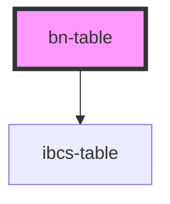

# bn-table

Component to create Tables.  The scenarios can be piced from the datasource.
the order of the scenarios is detemined by the parmeter scenarios.
Variances are calculated dynamicly.

## Mixins
@withStyle
@withComponentStatus
@withDataset
@withTranslation

**Example**
```html
      <bn-table
        datasets            ="$marktwert"
        category-width      ='inf'
        categorythereof     = '{"ac1": [{"name": "DE", "subGroups": ["Frankfurt"]}]}'
        data-format         ="decimal"
        data-format-digits-decimal = "2"
        data-format-digits-percent = "2"
        grouped             ="true"
        internationalisation = ''
        internationalisation-mode = ''
        limit               ='0'
        measure-scale       ='least'
        measure-type        ='currency'
        order               ='ac1'
        order-direction     ='desc'
        partof              ='[]'
        scenarios           ='ac1,pp1,dpp1_ac1_pos,drpp1_ac1_pos'
        show-group-title    ='true'
        table-title         ='Example Table'
        thereof             ='[
          {
            "rowgroup":     "Kosten",
            "category":     "lime",
            "subcategory":  ""
          }
          ]'
        type                ='opt' >
      </bn-table>
```
**Output**


<!-- Auto Generated Below -->


## Properties

| Property                  | Attribute                    | Description                                                                                                                                                                                                                                                                                                                                                                                                                                                                                                                                                                                                                                                                                                                                                                                                                                                                                                                                                                                                                                                                                                                                                                                                                  | Type     | Default      |
| ------------------------- | ---------------------------- | ---------------------------------------------------------------------------------------------------------------------------------------------------------------------------------------------------------------------------------------------------------------------------------------------------------------------------------------------------------------------------------------------------------------------------------------------------------------------------------------------------------------------------------------------------------------------------------------------------------------------------------------------------------------------------------------------------------------------------------------------------------------------------------------------------------------------------------------------------------------------------------------------------------------------------------------------------------------------------------------------------------------------------------------------------------------------------------------------------------------------------------------------------------------------------------------------------------------------------- | -------- | ------------ |
| `categoryWidth`           | `category-width`             | Set width of category column. <br /> If INF is selected the columns scaling to the min space they need seperatly. <br /><br /> values:<br /> ``` w5 // w10 // w15 // w20 // w25 // w50 // inf ```                                                                                                                                                                                                                                                                                                                                                                                                                                                                                                                                                                                                                                                                                                                                                                                                                                                                                                                                                                                                                            | `string` | `'w15'`      |
| `categorythereof`         | `categorythereof`            | Defines which drill-column is displayed. <br /> <br /><br /> ```name``` is the name of the parent column of the drill <br/> ```subGroups``` is a list of child columns of the parent <br/><br/> example:<br /> ```{"ac1": [{"name": "DE", "subGroups": ["Berlin"]},             {"name": "UK", "subGroups": []}],    }```                                                                                                                                                                                                                                                                                                                                                                                                                                                                                                                                                                                                                                                                                                                                                                                                                                                                                                    | `string` | `null`       |
| `dataFormat`              | `data-format`                | Defines the data unit type of the tables data. <br /><br /> If percent is chosen all data values are converted into percent (0.02 ->  2%) <br /><br /> values: <br /> ```percent  // decimal```                                                                                                                                                                                                                                                                                                                                                                                                                                                                                                                                                                                                                                                                                                                                                                                                                                                                                                                                                                                                                              | `string` | `'decimal'`  |
| `dataFormatDigitsDecimal` | `data-format-digits-decimal` | Number of decimal digits in a table cell                                                                                                                                                                                                                                                                                                                                                                                                                                                                                                                                                                                                                                                                                                                                                                                                                                                                                                                                                                                                                                                                                                                                                                                     | `number` | `1`          |
| `dataFormatDigitsPercent` | `data-format-digits-percent` | Number of percent digits in a table cell                                                                                                                                                                                                                                                                                                                                                                                                                                                                                                                                                                                                                                                                                                                                                                                                                                                                                                                                                                                                                                                                                                                                                                                     | `number` | `2`          |
| `grouped`                 | `grouped`                    | Toggles of data should be grouped by 'rowgroup'. <br /><br /> values: <br /> ```true // false```                                                                                                                                                                                                                                                                                                                                                                                                                                                                                                                                                                                                                                                                                                                                                                                                                                                                                                                                                                                                                                                                                                                             | `string` | `'false'`    |
| `limit`                   | `limit`                      | Set the maximum number of rows for each group. The value 0 means *no limit* <br /><br /> rows wich where cut by the limit are cumulated as REST                                                                                                                                                                                                                                                                                                                                                                                                                                                                                                                                                                                                                                                                                                                                                                                                                                                                                                                                                                                                                                                                              | `number` | `0`          |
| `measureScale`            | `measure-scale`              | Sets the SiPrefix of the Mesaurements and converts the original value. <br /><br /> values:  <br /> ```_ // k // M // G // T // P // E // Z // Y // m // μ // n // p // P // f // a // z // y // GREATEST // LEAST``` <br /><br /> SiPrefix overview: ```     "Y":  1E+24,```<br /> ```    "Z":  1E+21,```<br /> ```   "E":  1E+18,```<br /> ```     "P":  1E+15,```<br /> ```     "T":  1E+12,```<br /> ```     "G":  1000000000,```<br /> ```     "M":  1000000,```<br /> ```     "k":  1000,```<br /> <br /> ```     "m":  0.001,```<br /> ```    "μ":  0.000001,```<br /> ```     "n":  0.000000001,```<br /> ```     "p":  0.000000000001,```<br /> ```     "f":  0.000000000000001,```<br /> ```     "a":  0.000000000000000001,```<br /> ```     "z":  0.000000000000000000001,```<br /> ```     "y":  0.000000000000000000000001,```<br /> <br /><br /> Special modes: ```GREATEST``` seaches for the bigest (farest to zero) Value in the dataset and sets this value to SiPrefix<br /> ```LEAST```    searches for smallest (closest to zero) Value in the dataset and sets this value to SiPrefix<br /> <br /><br /> ```_```        is the value for no SiPrefix the value is displayed as in the dataset stored. | `string` | `"greatest"` |
| `measureType`             | `measure-type`               | Sets the Measure Type of the Table volume is different displayed and interpreted as currency names of siprefix are adapted. <br /><br /> values: <br /> ```volume // currency```                                                                                                                                                                                                                                                                                                                                                                                                                                                                                                                                                                                                                                                                                                                                                                                                                                                                                                                                                                                                                                             | `string` | `"volume"`   |
| `order`                   | `order`                      | List of the primary scenarios on which the order direction are applied  valid scenarios are If order is set to a scenario it has also exists in scenariolist <br /><br /> values: <br /> ```category // categoryindex // rowgroup // rowgroup // rowgroupindex // ac[1-4] // fc[1-4] // pp[1-4] // pl[1-4]```                                                                                                                                                                                                                                                                                                                                                                                                                                                                                                                                                                                                                                                                                                                                                                                                                                                                                                                | `string` | `'category'` |
| `orderDirection`          | `order-direction`            | Set sorting order direction <br /><br /> values: <br /> ```asc  // desc```                                                                                                                                                                                                                                                                                                                                                                                                                                                                                                                                                                                                                                                                                                                                                                                                                                                                                                                                                                                                                                                                                                                                                   | `string` | `'asc'`      |
| `partof`                  | `partof`                     | Stringified Array of Partof Objects <br />{<br />        "rowGroup": string,<br />        "category": string<br />      },<br /><br /> rowgroup, categroy defines the location of the drill percentage of category in rowgorup <br /><br /> example:<br /> ```[{ "rowGroups":"Umsatz", "category": "Applications", },]```                                                                                                                                                                                                                                                                                                                                                                                                                                                                                                                                                                                                                                                                                                                                                                                                                                                                                                    | `string` | `'[]'`       |
| `scenarios`               | `scenarios`                  | List of scenarios displayed in card header. <br /><br /> If scenarios is empty string (`''` or `null`) the scenarios are omitted <br /><br /> values:<br /> ```ac // fc // py // pl // null```                                                                                                                                                                                                                                                                                                                                                                                                                                                                                                                                                                                                                                                                                                                                                                                                                                                                                                                                                                                                                               | `string` | `undefined`  |
| `showGroupTitle`          | `show-group-title`           | Toggles a title header for each (row-)group the title header value is found set by 'rowgroup' <br /><br /> values: <br /> ```true // false```                                                                                                                                                                                                                                                                                                                                                                                                                                                                                                                                                                                                                                                                                                                                                                                                                                                                                                                                                                                                                                                                                | `string` | `'true'`     |
| `tableTitle`              | `table-title`                | A not mundane tile which should describes the shown data.                                                                                                                                                                                                                                                                                                                                                                                                                                                                                                                                                                                                                                                                                                                                                                                                                                                                                                                                                                                                                                                                                                                                                                    | `string` | `""`         |
| `thereof`                 | `thereof`                    | Stringified Array of drilldown Objects {        "rowGroup": string,<br />        "category": string,<br />        "subCategory": string,<br />      },<br /><br /> rowgroup, categroy defines the location of the drill subcategory is the displayed label of the data row <br /><br /> example:<br /> ```[{ "rowGroup":"Umsatz", "category": "Applications", "subCategory": "Applications-A", },]```                                                                                                                                                                                                                                                                                                                                                                                                                                                                                                                                                                                                                                                                                                                                                                                                                        | `string` | `'[]'`       |
| `type`                    | `type`                       | Set the table type <br /><br /> values: <br /> ```list // sum // opt // sumnototal // optnototal```                                                                                                                                                                                                                                                                                                                                                                                                                                                                                                                                                                                                                                                                                                                                                                                                                                                                                                                                                                                                                                                                                                                          | `string` | `'list'`     |
| `variances`               | `variances`                  | <br /> <br /> List of Variances The additonal variances which are calculated form the given scenarios. the scenarios used in the variances have also be defined in the *scenarios* property. <br /> <br /> the variance is defiend as  (Scenario A -  ScenarioB) neu. neg and pos post fix defines which value is *good* a negative or a positive value. <br /> <br /> if empty variance charts are hidden <br /> <br /> each variance creates a chart <br /> <br /> pattern:<br />  ```d<scenarioB>_<scenarioA>_[pos/neg/neu]```                                                                                                                                                                                                                                                                                                                                                                                                                                                                                                                                                                                                                                                                                            | `string` | `undefined`  |


## Dependencies

### Depends on

- ibcs-table

### Graph


----------------------------------------------

developed by Bino Bi
