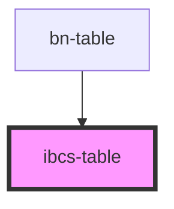

# bn-table

IBCS-compliant data table with scenario columns, variance calculations, row grouping, drill-down, and auto-scaling.

## Basic Usage

```html
<bn-table scenarios="ac1,pl1" variances="dac1_pl1_pos"></bn-table>
```

This renders a table with Actual and Plan columns plus an absolute variance column.

## Scenarios

Specify which scenario columns to display as a comma-separated list:

```html
<!-- Single scenario -->
<bn-table scenarios="ac1"></bn-table>

<!-- Multiple scenarios -->
<bn-table scenarios="ac1,pp1,fc1,pl1"></bn-table>

<!-- Auto-detect from dataset metadata -->
<bn-table scenarios="auto"></bn-table>
```

Available scenarios: `ac1`-`ac4` (actual), `pp1`-`pp4` (previous period), `fc1`-`fc4` (forecast), `pl1`-`pl4` (plan).

## Variances

Add computed variance columns. See the [Data Model](../../../doc/data-model.md) for the naming pattern:

```html
<!-- Absolute variance: Actual vs Plan, favorable when positive -->
<bn-table scenarios="ac1,pl1" variances="dac1_pl1_pos"></bn-table>

<!-- Multiple variances (absolute + relative) -->
<bn-table scenarios="ac1,pl1" variances="dac1_pl1_pos,drac1_pl1_pos"></bn-table>
```

## Table Types

| Type | Description |
|------|-------------|
| `list` | Plain list, no totals (default) |
| `sum` | List with grand total row |
| `opt` | List with group subtotals and grand total |
| `sumnototal` | List with grand total, no group subtotals |
| `optnototal` | List with group subtotals, no grand total |

```html
<bn-table type="sum" scenarios="ac1,pl1"></bn-table>
```

## Grouping

Enable row grouping by the `rowGroup` dimension:

```html
<bn-table grouped="true" type="opt" scenarios="ac1,pl1"></bn-table>
```

When `grouped="true"`, rows are organized under their `rowGroup` headers with subtotals per group.

## Drill-Down (Thereof / Part-Of)

**Thereof** shows detail rows broken down by subcategory:

```html
<bn-table
  scenarios="ac1,pl1"
  thereof='[{"rowgroup": "Revenue", "category": "Product Sales", "subcategory": ""}]'>
</bn-table>
```

**Part-of** shows percentage contribution rows:

```html
<bn-table
  scenarios="ac1,pl1"
  partof='[{"rowgroup": "Revenue", "category": "Product Sales", "subcategory": ""}]'>
</bn-table>
```

## Sorting

```html
<!-- Sort by category name -->
<bn-table order="category" order-direction="asc" scenarios="ac1"></bn-table>

<!-- Sort by actual values descending -->
<bn-table order="ac1" order-direction="desc" scenarios="ac1"></bn-table>

<!-- Auto-detect from dataset metadata -->
<bn-table order="auto" scenarios="ac1"></bn-table>
```

## Formatting

```html
<!-- Display as percentages -->
<bn-table data-format="percent" scenarios="ac1,pl1"></bn-table>

<!-- Custom decimal places -->
<bn-table
  data-format-digits-decimal="2"
  data-format-digits-percent="1"
  scenarios="ac1,pl1">
</bn-table>
```

## Scaling

Control the measure scale (SI prefix) for large numbers:

```html
<!-- Auto-detect smallest scale -->
<bn-table measure-scale="least" scenarios="ac1"></bn-table>

<!-- Fixed scale: thousands -->
<bn-table measure-scale="k" scenarios="ac1"></bn-table>

<!-- Fixed scale: millions -->
<bn-table measure-scale="M" scenarios="ac1"></bn-table>
```

Auto-scaling adjusts font size to fit the parent container:

```html
<!-- Silent auto-scale -->
<bn-table scale="auto" scenarios="ac1"></bn-table>

<!-- No scaling -->
<bn-table scale="none" scenarios="ac1"></bn-table>
```

Inline bar/pin charts (`bar-columns`) are scaled in data units per em:

```html
<!-- 1 em of bar = 1M units; a +2 % pin = 1 em -->
<bn-table unit-scaling="1M" percentage-scaling="2" bar-columns="dac1_pl1" scenarios="ac1,pl1"></bn-table>

<!-- Share one scale with charts via a scaling group -->
<bn-scaling-group name="revenue" value="1M"></bn-scaling-group>
<bn-table unit-scaling="revenue" bar-columns="dac1_pl1" scenarios="ac1,pl1"></bn-table>
```

See the [Scaling guide](../../../doc/scaling.md) for the full model.

## Column Widths

`category-width` and `bar-column-width` share one vocabulary: `wN` means **N em of the
table font**, so the same `N` gives the same rendered width for both.

```html
<!-- category column and bar column are both 25 em wide -->
<bn-table category-width="w25" bar-column-width="w25" bar-columns="dac1_pl1" scenarios="ac1,pl1"></bn-table>
```

`category-width` values: `w5`, `w10`, `w15`, `w20`, `w25`, `w50`, `w100`, `inf`
(`inf` = as wide as the labels need). A label too long for the column is truncated
with an ellipsis.

`bar-column-width` values: `w5`, `w10`, `w15`, `w20`, `w25`, `w30`, `w40`, `w60`, `w80`,
`w100`. The value is the **total** column width — the bar or pin drawing area is that
width minus the value-label gutters, split across both sides of the axis when the column
contains positive and negative values.

## Row Limit

Limit the number of rows per group, aggregating the rest into a "REST" row:

```html
<bn-table limit="5" scenarios="ac1,pl1"></bn-table>
```

## Full Example

```html
<bn-context locale="en">
  <bn-datasource name="pnl">
    [
      {"rowGroup":"Revenue","rowGroupIndex":1,"category":"Product Sales","operation":"+","ac1":150,"pl1":140},
      {"rowGroup":"Revenue","rowGroupIndex":1,"category":"Services","operation":"+","ac1":90,"pl1":95},
      {"rowGroup":"Costs","rowGroupIndex":2,"category":"Personnel","operation":"-","ac1":80,"pl1":75},
      {"rowGroup":"Costs","rowGroupIndex":2,"category":"Materials","operation":"-","ac1":40,"pl1":45}
    ]
  </bn-datasource>

  <bn-dataset name="pnl" datasources="pnl">
    SELECT rowGroup, rowGroupIndex, category, operation,
           SUM(ac1) as ac1, SUM(pl1) as pl1
    FROM pnl GROUP BY rowGroup, rowGroupIndex, category, operation
  </bn-dataset>

  <bn-page format="hd" orientation="landscape">
    <bn-title business-unit="ACME Corp" scenarios="ac1,pl1"
              measures='[{"name":"P&amp;L","unit":"kEUR"}]'></bn-title>
    <bn-body>
      <bn-table
        scenarios="ac1,pl1"
        variances="dac1_pl1_pos"
        grouped="true"
        type="opt"
        order="ac1"
        order-direction="desc"
        measure-scale="k">
      </bn-table>
    </bn-body>
  </bn-page>
</bn-context>
```

<!-- Auto Generated Below -->


## Overview

Internal rendering engine for `bn-table`.

Receives pre-validated, typed props from the outer `bn-table` wrapper and
builds the IBCS-compliant HTML table — including header rows, scenario
columns, variance columns (with optional inline bar/pin charts), thereof/
partof drill-down rows, and grouped row sections. This component should
not be used directly; use `bn-table` instead.

## Properties

| Property              | Attribute               | Description                                                                                                                                                                                                                              | Type                                                                                                                                                                                                           | Default                                                       |
| --------------------- | ----------------------- | ---------------------------------------------------------------------------------------------------------------------------------------------------------------------------------------------------------------------------------------- | -------------------------------------------------------------------------------------------------------------------------------------------------------------------------------------------------------------- | ------------------------------------------------------------- |
| `attributeColumns`    | --                      |                                                                                                                                                                                                                                          | `TableAttribute[]`                                                                                                                                                                                             | `[]`                                                          |
| `barColumnMaxWidth`   | `bar-column-max-width`  | Total width of a bar chart column, in em of the table font — the same unit `categoryWidth` uses, so the two render at the same width for the same value.                                                                                 | `number`                                                                                                                                                                                                       | `30`                                                          |
| `barColumns`          | --                      |                                                                                                                                                                                                                                          | `string[]`                                                                                                                                                                                                     | `[]`                                                          |
| `categoryWidth`       | `category-width`        |                                                                                                                                                                                                                                          | `TableCategoryWidth.INF \| TableCategoryWidth.W10 \| TableCategoryWidth.W100 \| TableCategoryWidth.W15 \| TableCategoryWidth.W20 \| TableCategoryWidth.W25 \| TableCategoryWidth.W5 \| TableCategoryWidth.W50` | `TableCategoryWidth.INF`                                      |
| `categorythereof`     | --                      |                                                                                                                                                                                                                                          | `Map<string, Record<string, unknown>[]>`                                                                                                                                                                       | `new Map()`                                                   |
| `dataFormatDigits`    | --                      |                                                                                                                                                                                                                                          | `DataFormatDigits`                                                                                                                                                                                             | `{ percent: 2, decimal: 1 }`                                  |
| `dataVersion`         | `data-version`          | Bumped by the outer `bn-table` whenever the dataset's data changes. Triggers a re-render via Stencil's prop-change detection.                                                                                                            | `number`                                                                                                                                                                                                       | `0`                                                           |
| `filter`              | `filter`                |                                                                                                                                                                                                                                          | `string`                                                                                                                                                                                                       | `""`                                                          |
| `grouped`             | `grouped`               |                                                                                                                                                                                                                                          | `boolean`                                                                                                                                                                                                      | `false`                                                       |
| `i18n`                | --                      |                                                                                                                                                                                                                                          | `Map<string, string>`                                                                                                                                                                                          | `new Map()`                                                   |
| `i18nMode`            | `i18n-mode`             |                                                                                                                                                                                                                                          | `I18nMode.ALL \| I18nMode.META`                                                                                                                                                                                | `I18nMode.ALL`                                                |
| `interval`            | `interval`              |                                                                                                                                                                                                                                          | `string`                                                                                                                                                                                                       | `"none"`                                                      |
| `limit`               | `limit`                 |                                                                                                                                                                                                                                          | `number`                                                                                                                                                                                                       | `0`                                                           |
| `measureScale`        | `measure-scale`         |                                                                                                                                                                                                                                          | `string`                                                                                                                                                                                                       | `"_"`                                                         |
| `measureType`         | `measure-type`          |                                                                                                                                                                                                                                          | `MeasureType.CURRENCY \| MeasureType.VOLUME`                                                                                                                                                                   | `MeasureType.VOLUME`                                          |
| `measureUnit`         | `measure-unit`          |                                                                                                                                                                                                                                          | `string`                                                                                                                                                                                                       | `""`                                                          |
| `order`               | --                      |                                                                                                                                                                                                                                          | `Order`                                                                                                                                                                                                        | `{     hierarchy: [],     direction: OrderDirection.ASC,   }` |
| `partof`              | --                      |                                                                                                                                                                                                                                          | `TableDrillGroup[]`                                                                                                                                                                                            | `[]`                                                          |
| `percentageScaling`   | `percentage-scaling`    |                                                                                                                                                                                                                                          | `number`                                                                                                                                                                                                       | `0.5`                                                         |
| `reportAutoScaling`   | --                      | Internal wrapper channel: called with the auto-fitted scaling values (em per unit / em per percentage point) whenever one of them was auto-resolved, so the outer `bn-table` can surface them in its AUTO_* warnings. Not for end users. | `(report: AutoScalingReport) => void`                                                                                                                                                                          | `undefined`                                                   |
| `ruleSetConfig`       | --                      |                                                                                                                                                                                                                                          | `RuleSetConfig`                                                                                                                                                                                                | `undefined`                                                   |
| `scaleFactor`         | `scale-factor`          |                                                                                                                                                                                                                                          | `number`                                                                                                                                                                                                       | `1`                                                           |
| `scenarios`           | --                      |                                                                                                                                                                                                                                          | `string[]`                                                                                                                                                                                                     | `[]`                                                          |
| `scenariosDataFormat` | `scenarios-data-format` |                                                                                                                                                                                                                                          | `DataFormat.DECIMAL \| DataFormat.PERCENT`                                                                                                                                                                     | `DataFormat.DECIMAL`                                          |
| `selectedStyle`       | `selected-style`        | Name of a registered component style, forwarded by the outer `bn-table`. Reflected so the `withComponentStyle` mixin can read the `selected-style` attribute from the host element.                                                      | `string`                                                                                                                                                                                                       | `undefined`                                                   |
| `showGroupTitle`      | `show-group-title`      |                                                                                                                                                                                                                                          | `boolean`                                                                                                                                                                                                      | `true`                                                        |
| `showMeasureScale`    | `show-measure-scale`    |                                                                                                                                                                                                                                          | `boolean`                                                                                                                                                                                                      | `true`                                                        |
| `sumTitle`            | `sum-title`             | Label of the grand-total row (`sum` / `opt` types only). The default `SUM_TOTAL` is an i18n key that resolves to the IBCS total symbol (❖).                                                                                              | `string`                                                                                                                                                                                                       | `"SUM_TOTAL"`                                                 |
| `tableName`           | `table-name`            | Name of the dataset (a table or view in the shared alasql database). The inner `Table` helper queries it directly — no array copy.                                                                                                       | `string`                                                                                                                                                                                                       | `""`                                                          |
| `thereof`             | --                      |                                                                                                                                                                                                                                          | `TableDrillGroup[]`                                                                                                                                                                                            | `[]`                                                          |
| `type`                | `type`                  |                                                                                                                                                                                                                                          | `TableType.LIST \| TableType.OPT \| TableType.OPTNOTOTAL \| TableType.SUM \| TableType.SUMNOTOTAL`                                                                                                             | `TableType.LIST`                                              |
| `unitScaling`         | `unit-scaling`          |                                                                                                                                                                                                                                          | `number`                                                                                                                                                                                                       | `0.01`                                                        |


## Methods

### `getLayoutDetail(origins: Origins, detail: "summary" | "full") => Promise<TableLayoutDetail>`

Collects the table's layout-state contribution: header/body regions,
counts, and — with `detail: "full"` — per-cell geometry paired with the
table model (values, column keys, in-cell bar charts). Called by the
outer `bn-table`; not for end users.

#### Parameters

| Name      | Type                  | Description |
| --------- | --------------------- | ----------- |
| `origins` | `Origins`             |             |
| `detail`  | `"summary" \| "full"` |             |

#### Returns

Type: `Promise<TableLayoutDetail>`


## Dependencies

### Used by

 - [bn-table](.)

### Graph


----------------------------------------------

developed by Bino Bi
