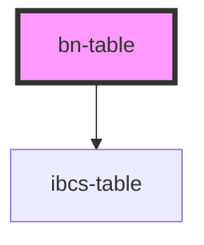

# bn-table

  

<!-- Auto Generated Below -->

## Properties

| Property         | Attribute          | Description | Type      | Default     |
| ---------------- | ------------------ | ----------- | --------- | ----------- |
| `grouped`        | `grouped`          |             | `boolean` | `undefined` |
| `limit`          | `limit`            |             | `number`  | `undefined` |
| `order`          | `order`            |             | `string`  | `undefined` |
| `orderDirection` | `order-direction`  |             | `string`  | `undefined` |
| `scenarios`      | `scenarios`        |             | `string`  | `undefined` |
| `showGroupTitle` | `show-group-title` |             | `boolean` | `undefined` |
| `tableTitle`     | `table-title`      |             | `string`  | `undefined` |
| `thereof`        | `thereof`          |             | `string`  | `undefined` |
| `type`           | `type`             |             | `string`  | `undefined` |

## Dependencies

### Depends on

- ibcs-table

### Graph

----------------------------------------------

*Built with [StencilJS](https://stenciljs.com/)*
