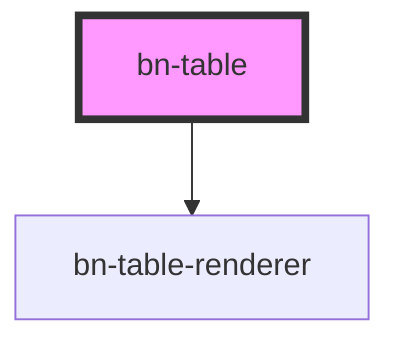

# bn-table

IBCS-compliant data table with scenario columns, variance calculations, row grouping, drill-down, and auto-scaling.

## Basic Usage

```html
<bn-table scenarios="ac1,pl1" variances="dac1_pl1_pos"></bn-table>
```

This renders a table with Actual and Plan columns plus an absolute variance column.

## Scenarios

Specify which scenario columns to display as a comma-separated list:

```html
<!-- Single scenario -->
<bn-table scenarios="ac1"></bn-table>

<!-- Multiple scenarios -->
<bn-table scenarios="ac1,pp1,fc1,pl1"></bn-table>

<!-- Auto-detect from dataset metadata -->
<bn-table scenarios="auto"></bn-table>
```

Available scenarios: `ac1`-`ac4` (actual), `pp1`-`pp4` (previous period), `fc1`-`fc4` (forecast), `pl1`-`pl4` (plan).

## Variances

Add computed variance columns. See the [Data Model](../../../doc/data-model.md) for the naming pattern:

```html
<!-- Absolute variance: Actual vs Plan, favorable when positive -->
<bn-table scenarios="ac1,pl1" variances="dac1_pl1_pos"></bn-table>

<!-- Multiple variances (absolute + relative) -->
<bn-table scenarios="ac1,pl1" variances="dac1_pl1_pos,drac1_pl1_pos"></bn-table>
```

A variance that prints as zero at the displayed digits (for example `0.04` at one decimal digit) has no sign and no direction color. Its cell has the class `zero`.

## Table Types

| Type | Description |
|------|-------------|
| `list` | Plain list, no totals (default) |
| `sum` | List with grand total row |
| `opt` | List with group subtotals and grand total |
| `sumnototal` | List with grand total, no group subtotals |
| `optnototal` | List with group subtotals, no grand total |

```html
<bn-table type="sum" scenarios="ac1,pl1"></bn-table>
```

## Grouping

Enable row grouping by the `rowGroup` dimension:

```html
<bn-table grouped="true" type="opt" scenarios="ac1,pl1"></bn-table>
```

When `grouped="true"`, rows are organized under their `rowGroup` headers with subtotals per group.

## Drill-Down (Thereof / Part-Of)

**Thereof** shows detail rows broken down by subcategory:

```html
<bn-table
  scenarios="ac1,pl1"
  thereof='[{"rowGroup": "Revenue", "category": "Product Sales", "subCategory": "Licenses"}]'>
</bn-table>
```

**Part-of** shows percentage contribution rows:

```html
<bn-table
  scenarios="ac1,pl1"
  partof='[{"rowGroup": "Revenue", "category": "Product Sales"}]'>
</bn-table>
```

With `thereof-position="above"` the thereof rows stand before their parent row, in normal size, with an indented label and without the thereof label. The parent row then closes them like a subtotal: bold, with a line above it. It keeps its operation sign and its value. The default `below` prints them below the parent, small and italic.

## Calculation Scheme (Running Results)

`running-sum="true"` turns the sum row of each row group into a running result: the sum of all rows from the first group down to its own group. Scenarios, absolute variances and relative variances all follow. This builds a calculation scheme such as an IBCS income statement, where each `rowGroup` is named after the result it ends in:

```html
<bn-table
  type="optnototal"
  grouped="true"
  show-group-title="false"
  running-sum="true"
  order="categoryindex"
  scenarios="pp1,pl1,ac1"
  variances="dac1_pp1_pos,drac1_pp1_pos"
  thereof='[{"rowGroup": "Operating result", "category": "Operating expenses", "subCategory": ""}]'
  thereof-position="above">
</bn-table>
```

```
+ Licences
+ Consulting
= Sales revenue          (group 1)
+ Other op. income
    Purchases
    Personnel expenses
- Operating expenses     (a "-" category with subCategory rows, value printed positive)
= Operating result       (groups 1 and 2)
- Income tax
= Result after tax       (groups 1 to 3)
```

Notes:

- It needs `grouped="true"` and a type with group sums (`sum`, `opt`, `sumnototal`, `optnototal`). An ungrouped table and a `list` table do not change.
- The results add up in the order the groups are printed, so order the groups by `rowGroupIndex`.
- The total row of `sum` and `opt` is not removed. It repeats the last running result, so use `sumnototal` or `optnototal`.
- Interval columns add up per block.
- `partof` shares still refer to the sum of their own group, not to the running result.
- A scenario bar column draws each result as a bar from zero, and the next rows walk on from its end.
- It is not supported together with `columnthereof`. With `columnthereof` set, `running-sum` has no effect.

## Sorting

```html
<!-- Sort by category name -->
<bn-table order="category" order-direction="asc" scenarios="ac1"></bn-table>

<!-- Sort by actual values descending -->
<bn-table order="ac1" order-direction="desc" scenarios="ac1"></bn-table>

<!-- Auto-detect from dataset metadata -->
<bn-table order="auto" scenarios="ac1"></bn-table>
```

## Formatting

```html
<!-- Display as percentages -->
<bn-table data-format="percent" scenarios="ac1,pl1"></bn-table>

<!-- Custom decimal places -->
<bn-table
  data-format-digits-decimal="2"
  data-format-digits-percent="1"
  scenarios="ac1,pl1">
</bn-table>
```

## Scaling

Control the measure scale (SI prefix) for large numbers:

```html
<!-- Auto-detect smallest scale -->
<bn-table measure-scale="least" scenarios="ac1"></bn-table>

<!-- Fixed scale: thousands -->
<bn-table measure-scale="k" scenarios="ac1"></bn-table>

<!-- Fixed scale: millions -->
<bn-table measure-scale="M" scenarios="ac1"></bn-table>
```

Auto-scaling adjusts font size to fit the parent container:

```html
<!-- Silent auto-scale -->
<bn-table scale="auto" scenarios="ac1"></bn-table>

<!-- No scaling -->
<bn-table scale="none" scenarios="ac1"></bn-table>
```

Inline bar/pin charts (`bar-columns`) are scaled in data units per em:

```html
<!-- 1 em of bar = 1M units; a +2 % pin = 1 em -->
<bn-table unit-scaling="1M" percentage-scaling="2" bar-columns="dac1_pl1" scenarios="ac1,pl1"></bn-table>

<!-- Share one scale with charts via a scaling group -->
<bn-scaling-group name="revenue" value="1M"></bn-scaling-group>
<bn-table unit-scaling="revenue" bar-columns="dac1_pl1" scenarios="ac1,pl1"></bn-table>
```

See the [Scaling guide](../../../doc/scaling.md) for the full model.

## Column Widths

`category-width` and `bar-column-width` share one vocabulary: `wN` means **N em of the
table font**, so the same `N` gives the same rendered width for both.

```html
<!-- category column and bar column are both 25 em wide -->
<bn-table category-width="w25" bar-column-width="w25" bar-columns="dac1_pl1" scenarios="ac1,pl1"></bn-table>
```

`category-width` values: `w5`, `w10`, `w15`, `w20`, `w25`, `w50`, `w100`, `inf`
(`inf` = as wide as the labels need). A label too long for the column is truncated
with an ellipsis.

`bar-column-width` values: `w5`, `w10`, `w15`, `w20`, `w25`, `w30`, `w40`, `w60`, `w80`,
`w100`. The value is the **total** column width - the bar or pin drawing area is that
width minus the value-label gutters, split across both sides of the axis when the column
contains positive and negative values.

A waterfall column measures its value labels, total rows included, and keeps on each side
only the room the labels need there; the bars get the rest. A column whose bars all point
right has no label room on the left. In a thereof or partof row, the dashed guide at the
end of the parent bar is left out where it would run through the value label. The guide
at the start of the parent bar is always drawn. The zero axis line is left out in a row
the same way.

## Row Limit

Limit the number of rows per group, aggregating the rest into a "REST" row:

```html
<bn-table limit="5" scenarios="ac1,pl1"></bn-table>
```

## Interval Columns

`interval` repeats the scenario and variance columns once per interval group, under a
header band with the group labels. Date values (`year`, `quarter`, `month`, ...) group
by the `date` column, `setname` groups by the `setname` column.

```html
<!-- one block per year -->
<bn-table interval="year" scenarios="ac1,pl1"></bn-table>

<!-- one block per setname: Jan | Feb | Mar | YTD -->
<bn-table interval="setname" scenarios="ac1,pl1"></bn-table>
```

Date groups are in chronological order. Setname groups are in order of first appearance
in the data. Add the optional numeric column `setnameIndex` to the rows to set the order:
the groups are then sorted ascending by it.

`category-interval-position` moves the category column between the groups. The value is
the number of groups left of it:

```html
<!-- Jan | Feb | Mar | category | YTD -->
<bn-table interval="setname" category-interval-position="3" scenarios="ac1,pl1"></bn-table>
```

The operation column and the `attributes` columns move with the category column. A value
greater than the number of groups gives a warning and puts the category column last.

## Full Example

```html
<bn-context locale="en">
  <bn-datasource name="pnl_raw">
    [
      {"rowGroup":"Revenue","rowGroupIndex":1,"category":"Product Sales","operation":"+","ac1":150,"pl1":140},
      {"rowGroup":"Revenue","rowGroupIndex":1,"category":"Services","operation":"+","ac1":90,"pl1":95},
      {"rowGroup":"Costs","rowGroupIndex":2,"category":"Personnel","operation":"-","ac1":80,"pl1":75},
      {"rowGroup":"Costs","rowGroupIndex":2,"category":"Materials","operation":"-","ac1":40,"pl1":45}
    ]
  </bn-datasource>

  <bn-dataset name="pnl" datasources="pnl_raw">
    SELECT rowGroup, rowGroupIndex, category, operation,
           SUM(ac1) as ac1, SUM(pl1) as pl1
    FROM pnl_raw GROUP BY rowGroup, rowGroupIndex, category, operation
  </bn-dataset>

  <bn-page format="hd" orientation="landscape">
    <bn-title business-unit="ACME Corp" scenarios="ac1,pl1"
              measures='[{"name":"P&amp;L","unit":"kEUR"}]'></bn-title>
    <bn-body>
      <bn-table
        datasets="pnl"
        scenarios="ac1,pl1"
        variances="dac1_pl1_pos"
        grouped="true"
        type="opt"
        order="ac1"
        order-direction="desc"
        measure-scale="k">
      </bn-table>
    </bn-body>
  </bn-page>
</bn-context>
```

<!-- Auto Generated Below -->


## Overview

Public-facing wrapper for the IBCS table component.

Accepts user-facing string/number props, validates them, and converts
them into the typed internal format expected by `bn-table-renderer`. Handles
auto-scaling, dataset subscription (via `withDataset`), and i18n setup.
The actual table rendering (header, body, drill-down rows) is delegated
to the inner `bn-table-renderer` element.

## Properties

| Property                   | Attribute                    | Description                                                                                                                                                                                                                                                                                                                                                                                                                                                                                                                                                                                                                                                                                                                                                                                                                                                                                                                                                                                                                                                                                                                                                                                                                                                                                                                                                                                                                                                                                                                                                                                                                                                                                                                                                                                                                                                                                                                                                                                                                                                                                                                                                                                                                                                                                                                                                                                                                                                                                                                                                                                                                                                                                                                                                                                                                                                                                                                                                                                                                                                                                  | Type               | Default      |
| -------------------------- | ---------------------------- | -------------------------------------------------------------------------------------------------------------------------------------------------------------------------------------------------------------------------------------------------------------------------------------------------------------------------------------------------------------------------------------------------------------------------------------------------------------------------------------------------------------------------------------------------------------------------------------------------------------------------------------------------------------------------------------------------------------------------------------------------------------------------------------------------------------------------------------------------------------------------------------------------------------------------------------------------------------------------------------------------------------------------------------------------------------------------------------------------------------------------------------------------------------------------------------------------------------------------------------------------------------------------------------------------------------------------------------------------------------------------------------------------------------------------------------------------------------------------------------------------------------------------------------------------------------------------------------------------------------------------------------------------------------------------------------------------------------------------------------------------------------------------------------------------------------------------------------------------------------------------------------------------------------------------------------------------------------------------------------------------------------------------------------------------------------------------------------------------------------------------------------------------------------------------------------------------------------------------------------------------------------------------------------------------------------------------------------------------------------------------------------------------------------------------------------------------------------------------------------------------------------------------------------------------------------------------------------------------------------------------------------------------------------------------------------------------------------------------------------------------------------------------------------------------------------------------------------------------------------------------------------------------------------------------------------------------------------------------------------------------------------------------------------------------------------------------------------------- | ------------------ | ------------ |
| `barColumnWidth`           | `bar-column-width`           | Set the total width of bar chart columns, in em of the table font - the same unit and vocabulary as ```categoryWidth```, so ```bar-column-width="w15"``` renders exactly as wide as ```category-width="w15"```. The bar/pin drawing area is that width minus the value-label gutters. <br /><br /> values:<br /> ``` w5 // w10 // w15 // w20 // w25 // w30 // w40 // w60 // w80 // w100 ```                                                                                                                                                                                                                                                                                                                                                                                                                                                                                                                                                                                                                                                                                                                                                                                                                                                                                                                                                                                                                                                                                                                                                                                                                                                                                                                                                                                                                                                                                                                                                                                                                                                                                                                                                                                                                                                                                                                                                                                                                                                                                                                                                                                                                                                                                                                                                                                                                                                                                                                                                                                                                                                                                                  | `string`           | `"w10"`      |
| `barColumns`               | `bar-columns`                | List of column names to render as bar charts instead of numbers. <br /><br /> Absolute variances (d_*) render as horizontal bar charts. Relative variances (dr_*) render as pin charts with a square head. Bars take the pattern of the minuend (FC hatched, PL outlined) in the colour of the sentiment; pin heads take the look of the minuend scenario (AC solid dark, PY solid grey, FC hatched, PL outlined); the axis takes the look of the reference scenario. Scenario columns (ac1..pl4) render as horizontal bar charts; when the table contains grouping structure (sum rows, thereof, or partof) they automatically render as an IBCS waterfall - data rows cascade from the running total and sum rows anchor at zero. Waterfall columns auto-scale to fit the bar column width (unit-scaling does not apply) and are not supported in combination with `interval` or `columnthereof`. <br /><br /> example:<br /> ```dac1_pp1_pos,drac1_pp1_pos,ac1```                                                                                                                                                                                                                                                                                                                                                                                                                                                                                                                                                                                                                                                                                                                                                                                                                                                                                                                                                                                                                                                                                                                                                                                                                                                                                                                                                                                                                                                                                                                                                                                                                                                                                                                                                                                                                                                                                                                                                                                                                                                                                                                         | `string`           | `undefined`  |
| `categoryIntervalPosition` | `category-interval-position` | Number of interval groups that stand left of the category column. Needs an active `interval`. <br /><br /> ```0``` (default) keeps the category column first. ```1``` puts one interval group left of it and the rest right. The number of interval groups puts the category column last. A greater value raises a warning and is used as the number of groups. <br /><br /> The operation column and the `attributes` columns move with the category column.                                                                                                                                                                                                                                                                                                                                                                                                                                                                                                                                                                                                                                                                                                                                                                                                                                                                                                                                                                                                                                                                                                                                                                                                                                                                                                                                                                                                                                                                                                                                                                                                                                                                                                                                                                                                                                                                                                                                                                                                                                                                                                                                                                                                                                                                                                                                                                                                                                                                                                                                                                                                                                | `number`           | `0`          |
| `categoryWidth`            | `category-width`             | Set width of category column, in em of the table font. <br /> If INF is selected the columns scaling to the min space they need seperatly. <br /><br /> The column is fixed at this width; a category label too long to fit is truncated with an ellipsis. <br /><br /> values:<br /> ``` w5 // w10 // w15 // w20 // w25 // w50 // inf ```                                                                                                                                                                                                                                                                                                                                                                                                                                                                                                                                                                                                                                                                                                                                                                                                                                                                                                                                                                                                                                                                                                                                                                                                                                                                                                                                                                                                                                                                                                                                                                                                                                                                                                                                                                                                                                                                                                                                                                                                                                                                                                                                                                                                                                                                                                                                                                                                                                                                                                                                                                                                                                                                                                                                                   | `string`           | `"w15"`      |
| `columnthereof`            | `columnthereof`              | JSON array that defines which drill columns are shown. Each object has the keys `scenario`, `name` and `subGroups` (all required). <br /><br /> ```scenario``` the scenario to drill <br/> ```name``` the label of the parent column <br/> ```subGroups``` the list of child columns of the parent <br/><br/> example:<br /> ```[{"scenario": "ac1", "name": "DE", "subGroups": ["Berlin"]}, {"scenario": "ac2", "name": "UK", "subGroups": []}]```                                                                                                                                                                                                                                                                                                                                                                                                                                                                                                                                                                                                                                                                                                                                                                                                                                                                                                                                                                                                                                                                                                                                                                                                                                                                                                                                                                                                                                                                                                                                                                                                                                                                                                                                                                                                                                                                                                                                                                                                                                                                                                                                                                                                                                                                                                                                                                                                                                                                                                                                                                                                                                          | `string`           | `null`       |
| `dataFormat`               | `data-format`                | Defines the data unit type of the tables data. <br /><br /> If percent is chosen all data values are converted into percent (0.02 ->  2%) <br /><br /> values: <br /> ```percent  // decimal```                                                                                                                                                                                                                                                                                                                                                                                                                                                                                                                                                                                                                                                                                                                                                                                                                                                                                                                                                                                                                                                                                                                                                                                                                                                                                                                                                                                                                                                                                                                                                                                                                                                                                                                                                                                                                                                                                                                                                                                                                                                                                                                                                                                                                                                                                                                                                                                                                                                                                                                                                                                                                                                                                                                                                                                                                                                                                              | `string`           | `"decimal"`  |
| `dataFormatDigitsDecimal`  | `data-format-digits-decimal` | Number of decimal digits in a table cell                                                                                                                                                                                                                                                                                                                                                                                                                                                                                                                                                                                                                                                                                                                                                                                                                                                                                                                                                                                                                                                                                                                                                                                                                                                                                                                                                                                                                                                                                                                                                                                                                                                                                                                                                                                                                                                                                                                                                                                                                                                                                                                                                                                                                                                                                                                                                                                                                                                                                                                                                                                                                                                                                                                                                                                                                                                                                                                                                                                                                                                     | `number`           | `1`          |
| `dataFormatDigitsPercent`  | `data-format-digits-percent` | Number of percent digits in a table cell                                                                                                                                                                                                                                                                                                                                                                                                                                                                                                                                                                                                                                                                                                                                                                                                                                                                                                                                                                                                                                                                                                                                                                                                                                                                                                                                                                                                                                                                                                                                                                                                                                                                                                                                                                                                                                                                                                                                                                                                                                                                                                                                                                                                                                                                                                                                                                                                                                                                                                                                                                                                                                                                                                                                                                                                                                                                                                                                                                                                                                                     | `number`           | `2`          |
| `datasets`                 | `datasets`                   | Name of the dataset to render (the `name` of a `<bn-dataset>`). A name that starts with `$` reads a `<bn-datasource>` directly, which gives a warning.                                                                                                                                                                                                                                                                                                                                                                                                                                                                                                                                                                                                                                                                                                                                                                                                                                                                                                                                                                                                                                                                                                                                                                                                                                                                                                                                                                                                                                                                                                                                                                                                                                                                                                                                                                                                                                                                                                                                                                                                                                                                                                                                                                                                                                                                                                                                                                                                                                                                                                                                                                                                                                                                                                                                                                                                                                                                                                                                       | `string`           | `undefined`  |
| `filter`                   | `filter`                     | AlaSQL WHERE clause fragment injected into the data query to filter rows before rendering (e.g. `"category = 'Sales'"`).                                                                                                                                                                                                                                                                                                                                                                                                                                                                                                                                                                                                                                                                                                                                                                                                                                                                                                                                                                                                                                                                                                                                                                                                                                                                                                                                                                                                                                                                                                                                                                                                                                                                                                                                                                                                                                                                                                                                                                                                                                                                                                                                                                                                                                                                                                                                                                                                                                                                                                                                                                                                                                                                                                                                                                                                                                                                                                                                                                     | `string`           | `""`         |
| `grouped`                  | `grouped`                    | Toggles of data should be grouped by 'rowgroup'. <br /><br /> values: <br /> ```true // false```                                                                                                                                                                                                                                                                                                                                                                                                                                                                                                                                                                                                                                                                                                                                                                                                                                                                                                                                                                                                                                                                                                                                                                                                                                                                                                                                                                                                                                                                                                                                                                                                                                                                                                                                                                                                                                                                                                                                                                                                                                                                                                                                                                                                                                                                                                                                                                                                                                                                                                                                                                                                                                                                                                                                                                                                                                                                                                                                                                                             | `boolean`          | `false`      |
| `i18nNamespace`            | `i18n-namespace`             | Namespace of the translations to use (the `namespace` of a `<bn-internationalization>`). Without it the component takes the `i18n-namespace` of the nearest ancestor that has one, then the built-in texts.                                                                                                                                                                                                                                                                                                                                                                                                                                                                                                                                                                                                                                                                                                                                                                                                                                                                                                                                                                                                                                                                                                                                                                                                                                                                                                                                                                                                                                                                                                                                                                                                                                                                                                                                                                                                                                                                                                                                                                                                                                                                                                                                                                                                                                                                                                                                                                                                                                                                                                                                                                                                                                                                                                                                                                                                                                                                                  | `string`           | `undefined`  |
| `interval`                 | `interval`                   | Repeats the entire scenario/variance column block once per interval group, rendered under a spanning header band (e.g. `2023 \| 2024 \| 2025`, each with the configured columns). <br /><br /> values:<br /> ```none // setname // year // quarter // month // week // day // hour // minute // second // millisecond // auto``` <br /><br /> ```none``` (default) deactivates the feature. ```setname``` groups by the dataset's `setname` column (non-date comparison); rows with a blank setname raise a warning and are grouped under `-`. Date values bucket rows by the `date` column; ```auto``` detects the granularity from the date span. Cannot be combined with `columnthereof`. <br /><br /> Date groups are shown in chronological order. Setname groups are shown in order of first appearance in the dataset. When the rows carry the optional numeric column `setnameIndex`, the setname groups are sorted ascending by it: the smallest index of a setname counts, groups without an index come last.                                                                                                                                                                                                                                                                                                                                                                                                                                                                                                                                                                                                                                                                                                                                                                                                                                                                                                                                                                                                                                                                                                                                                                                                                                                                                                                                                                                                                                                                                                                                                                                                                                                                                                                                                                                                                                                                                                                                                                                                                                                                      | `string`           | `"none"`     |
| `limit`                    | `limit`                      | Set the maximum number of rows for each group. The value 0 means *no limit* <br /><br /> rows wich where cut by the limit are cumulated as REST                                                                                                                                                                                                                                                                                                                                                                                                                                                                                                                                                                                                                                                                                                                                                                                                                                                                                                                                                                                                                                                                                                                                                                                                                                                                                                                                                                                                                                                                                                                                                                                                                                                                                                                                                                                                                                                                                                                                                                                                                                                                                                                                                                                                                                                                                                                                                                                                                                                                                                                                                                                                                                                                                                                                                                                                                                                                                                                                              | `number`           | `0`          |
| `measureScale`             | `measure-scale`              | Sets the SiPrefix of the Mesaurements and converts the original value. <br /><br /> values:  <br /> ```_ // k // M // G // T // P // E // Z // Y // m // my (μ) // n // p // f // a // z // y // GREATEST // LEAST``` <br /><br /> SiPrefix overview: ```     "Y":  1E+24,```<br /> ```    "Z":  1E+21,```<br /> ```   "E":  1E+18,```<br /> ```     "P":  1E+15,```<br /> ```     "T":  1E+12,```<br /> ```     "G":  1000000000,```<br /> ```     "M":  1000000,```<br /> ```     "k":  1000,```<br /> <br /> ```     "m":  0.001,```<br /> ```    "my" (μ):  0.000001,```<br /> ```     "n":  0.000000001,```<br /> ```     "p":  0.000000000001,```<br /> ```     "f":  0.000000000000001,```<br /> ```     "a":  0.000000000000000001,```<br /> ```     "z":  0.000000000000000000001,```<br /> ```     "y":  0.000000000000000000000001,```<br /> <br /><br /> Special modes: ```GREATEST``` seaches for the bigest (farest to zero) Value in the dataset and sets this value to SiPrefix<br /> ```LEAST```    searches for smallest (closest to zero) Value in the dataset and sets this value to SiPrefix<br /> <br /><br /> ```_```        is the value for no SiPrefix the value is displayed as in the dataset stored.                                                                                                                                                                                                                                                                                                                                                                                                                                                                                                                                                                                                                                                                                                                                                                                                                                                                                                                                                                                                                                                                                                                                                                                                                                                                                                                                                                                                                                                                                                                                                                                                                                                                                                                                                                                                                                                            | `string`           | `"greatest"` |
| `measureType`              | `measure-type`               | Sets the Measure Type of the Table volume is different displayed and interpreted as currency names of siprefix are adapted. <br /><br /> values: <br /> ```volume // currency```                                                                                                                                                                                                                                                                                                                                                                                                                                                                                                                                                                                                                                                                                                                                                                                                                                                                                                                                                                                                                                                                                                                                                                                                                                                                                                                                                                                                                                                                                                                                                                                                                                                                                                                                                                                                                                                                                                                                                                                                                                                                                                                                                                                                                                                                                                                                                                                                                                                                                                                                                                                                                                                                                                                                                                                                                                                                                                             | `string`           | `"volume"`   |
| `measureUnit`              | `measure-unit`               | measureUnit displayed in table.                                                                                                                                                                                                                                                                                                                                                                                                                                                                                                                                                                                                                                                                                                                                                                                                                                                                                                                                                                                                                                                                                                                                                                                                                                                                                                                                                                                                                                                                                                                                                                                                                                                                                                                                                                                                                                                                                                                                                                                                                                                                                                                                                                                                                                                                                                                                                                                                                                                                                                                                                                                                                                                                                                                                                                                                                                                                                                                                                                                                                                                              | `string`           | `""`         |
| `order`                    | `order`                      | Comma list of the columns the rows are sorted by, left to right. `orderDirection` applies to all of them. <br /><br /> values: <br /> ```category // categoryindex // rowgroup // rowgroupindex // subcategory // subcategoryindex // ac[1-4] // fc[1-4] // pp[1-4] // pl[1-4] // auto``` <br /> or a variance, written like a scenario column, the sentiment is optional and ignored: ```dac1_pp1```, ```drfc1_pp1_pos``` <br /><br /> With `interval="setname"` a scenario or variance can name one bucket after `@`: ```dac1_pp1@_November``` sorts by that block only. Without a bucket the sum over all buckets is used. <br /><br /> The scenario or variance does not have to be a shown column; the sort arrow appears only on a shown one. A plain scenario also sorts the row groups by their sum. A variance or a token with `@` sorts only the rows inside each group, the groups keep their rowgroupindex order. With a variance or `@`, rows without data (and a relative variance with a zero reference) sort last. <br /><br /> A data row with the category `REST` is the rest row of its group: sorted by a scenario or variance it stays the last row of the group. Its label comes from the `REST` translation. <br /><br /> When set to ```auto```, order is detected from the dataset silently.                                                                                                                                                                                                                                                                                                                                                                                                                                                                                                                                                                                                                                                                                                                                                                                                                                                                                                                                                                                                                                                                                                                                                                                                                                                                                                                                                                                                                                                                                                                                                                                                                                                                                                                                                                        | `string`           | `"category"` |
| `orderDirection`           | `order-direction`            | Set sorting order direction <br /><br /> values: <br /> ```asc  // desc```                                                                                                                                                                                                                                                                                                                                                                                                                                                                                                                                                                                                                                                                                                                                                                                                                                                                                                                                                                                                                                                                                                                                                                                                                                                                                                                                                                                                                                                                                                                                                                                                                                                                                                                                                                                                                                                                                                                                                                                                                                                                                                                                                                                                                                                                                                                                                                                                                                                                                                                                                                                                                                                                                                                                                                                                                                                                                                                                                                                                                   | `string`           | `"asc"`      |
| `partof`                   | `partof`                     | JSON array of part-of objects with the keys `rowGroup` and `category` (both strings, both required). <br /><br /> Each object names a category. The table shows its share of the row group in percent. <br /><br /> example:<br /> ```[{"rowGroup": "Umsatz", "category": "Applications"}]```                                                                                                                                                                                                                                                                                                                                                                                                                                                                                                                                                                                                                                                                                                                                                                                                                                                                                                                                                                                                                                                                                                                                                                                                                                                                                                                                                                                                                                                                                                                                                                                                                                                                                                                                                                                                                                                                                                                                                                                                                                                                                                                                                                                                                                                                                                                                                                                                                                                                                                                                                                                                                                                                                                                                                                                                | `string`           | `"[]"`       |
| `percentageScaling`        | `percentage-scaling`         | Percentage points displayed per 1 em of pin length for relative variance pin charts (ΔPY%) - a larger value means shorter pins.  \| Value            \| Behavior                                                       \| \|------------------\|----------------------------------------------------------------\| \| `"auto"`         \| Auto-fit the largest pin to the pin area                       \| \| `"10"`, `"2.5"`  \| Percentage points per em; optional SI suffix `k`/`K`/`M`/`G`/`T` \| \| group name       \| References a `<bn-scaling-group>` for synchronized scaling     \| \| invalid / unknown \| Auto-fit + `AUTO_percentageScaling` warning                   \|  Default: `"2"` (a +2 % variance pin is 1 em long)                                                                                                                                                                                                                                                                                                                                                                                                                                                                                                                                                                                                                                                                                                                                                                                                                                                                                                                                                                                                                                                                                                                                                                                                                                                                                                                                                                                                                                                                                                                                                                                                                                                                                                                                                                                                                                                                                                                                                                                                                                                                                                                                                                                                                                                                                                                                                  | `number \| string` | `"2"`        |
| `ruleset`                  | `ruleset`                    | Name of a registered IBCS rule set (see `bn-ruleset`) used for scenario ordering, look and names. Supports `"inherited-closest"` / `"inherited-page"` to take over the value from an ancestor `bn-layout-card` / `bn-layout-page`.                                                                                                                                                                                                                                                                                                                                                                                                                                                                                                                                                                                                                                                                                                                                                                                                                                                                                                                                                                                                                                                                                                                                                                                                                                                                                                                                                                                                                                                                                                                                                                                                                                                                                                                                                                                                                                                                                                                                                                                                                                                                                                                                                                                                                                                                                                                                                                                                                                                                                                                                                                                                                                                                                                                                                                                                                                                           | `string`           | `undefined`  |
| `runningSum`               | `running-sum`                | Turns the sum row of each (row-)group into a running result: the sum of all rows from the first group down to its own group, with the matching absolute and relative variances. Use it for a calculation scheme such as an income statement, where each `rowGroup` ends in a result. <br /><br /> Needs `grouped` and a type with group sums (```sum // opt // sumnototal // optnototal```). The total row of ```sum``` and ```opt``` stays and repeats the last running result, so ```sumnototal``` or ```optnototal``` is the usual choice. `partof` shares still refer to the sum of their own group. Not supported together with `columnthereof`: there it has no effect. <br /><br /> values: <br /> ```true // false```                                                                                                                                                                                                                                                                                                                                                                                                                                                                                                                                                                                                                                                                                                                                                                                                                                                                                                                                                                                                                                                                                                                                                                                                                                                                                                                                                                                                                                                                                                                                                                                                                                                                                                                                                                                                                                                                                                                                                                                                                                                                                                                                                                                                                                                                                                                                                                | `boolean`          | `false`      |
| `scale`                    | `scale`                      | Controls proportional scaling of the entire table relative to the available parent width. All visual dimensions scale together: font size, em-based spacing/padding, SVG bar-chart widths, pin lengths, dot radii, pattern fills, axis strokes, and label offsets.  Scaling is driven by a single factor applied to the base font size (`global.fontSizePx` from the component-style store, default 13.3333 px). Because the table's SCSS uses `em` units for padding, borders, and column widths, changing the font size cascades to all layout dimensions. SVG elements (bars, pins, patterns) receive the factor via the `scaleFactor` prop on `bn-table-renderer` and multiply every pixel constant by it, so they stay proportional to the surrounding text.  \| Value               \| Behavior                                                                         \| \|---------------------\|----------------------------------------------------------------------------------\| \| not set / `""`      \| Auto-scale to fit parent width; emit `AUTO_scale` warning with the applied factor \| \| `"none"`            \| No scaling (render at base font size regardless of available space)               \| \| `"auto"`            \| Auto-scale to fit parent width silently (no warning)                             \| \| `"0.5"`, `"1.2"`, … \| Fixed factor - apply `baseFontSize × factor`                                     \|  **Auto-scale algorithm** (modes `""` and `"auto"`): 1. After each render, the current `scrollWidth` of the host element is    divided by the current `appliedScaleFactor` to derive the unscaled    content width. This avoids resetting `--bn-font-size` to base (which    would only affect em-based widths but not SVG pixel attributes). 2. This unscaled width is compared against the parent's content-box    width (via `getParentDimensions`). 3. If the table overflows, `factor = parentWidth / unscaledWidth`    is computed and applied to both the CSS variable and the    `appliedScaleFactor` state (which re-renders the SVG charts). 4. A guard flag (`_autoScaleGuard`) prevents the subsequent    state-triggered re-render from re-measuring, avoiding an infinite    measure → scale → fits → reset → overflow loop.  Invalid values (negative numbers, non-numeric strings that are not `"none"` or `"auto"`) fall back to the default behaviour (auto + warning) and emit an `WARN_scale` warning.  **Only the width is fitted.** A table that renders taller than its constrained parent is clipped by the layout cell - bottom rows and the grand total simply disappear - so every render reports the measured overflow in `has-error`: as the error `ERR_overflow` when the size is pinned by `scale` (`"none"` or a factor), as the warning `WARN_overflow` in auto mode. The same item reports a width overflow, which only a fixed `scale` can produce. Setting `scale="auto"` does not fix a height overflow: give the component more space, reduce rows (`limit`), or set a smaller fixed `scale`. | `string`           | `undefined`  |
| `scenarios`                | `scenarios`                  | List of scenarios displayed in card header. <br /><br /> If scenarios is empty string (`''` or `null`) the scenarios are omitted <br /><br /> values:<br /> ```ac // fc // py // pl // null // auto``` <br /><br /> When set to ```auto```, scenarios are detected from the dataset silently. When left blank (and variances are also blank), scenarios are detected from the dataset with a warning.                                                                                                                                                                                                                                                                                                                                                                                                                                                                                                                                                                                                                                                                                                                                                                                                                                                                                                                                                                                                                                                                                                                                                                                                                                                                                                                                                                                                                                                                                                                                                                                                                                                                                                                                                                                                                                                                                                                                                                                                                                                                                                                                                                                                                                                                                                                                                                                                                                                                                                                                                                                                                                                                                        | `string`           | `undefined`  |
| `selectedStyle`            | `selected-style`             | Name of a registered component style (see `bn-component-style`). Forwarded to the inner `bn-table-renderer` so bar-chart colors and fonts follow the selected style as well.                                                                                                                                                                                                                                                                                                                                                                                                                                                                                                                                                                                                                                                                                                                                                                                                                                                                                                                                                                                                                                                                                                                                                                                                                                                                                                                                                                                                                                                                                                                                                                                                                                                                                                                                                                                                                                                                                                                                                                                                                                                                                                                                                                                                                                                                                                                                                                                                                                                                                                                                                                                                                                                                                                                                                                                                                                                                                                                 | `string`           | `undefined`  |
| `showGroupTitle`           | `show-group-title`           | Toggles a title header for each (row-)group the title header value is found set by 'rowgroup' <br /><br /> values: <br /> ```true // false```                                                                                                                                                                                                                                                                                                                                                                                                                                                                                                                                                                                                                                                                                                                                                                                                                                                                                                                                                                                                                                                                                                                                                                                                                                                                                                                                                                                                                                                                                                                                                                                                                                                                                                                                                                                                                                                                                                                                                                                                                                                                                                                                                                                                                                                                                                                                                                                                                                                                                                                                                                                                                                                                                                                                                                                                                                                                                                                                                | `boolean`          | `true`       |
| `showMeasureScale`         | `show-measure-scale`         | Toggles display of measure units in table header <br /><br /> values: <br /> ```true // false```                                                                                                                                                                                                                                                                                                                                                                                                                                                                                                                                                                                                                                                                                                                                                                                                                                                                                                                                                                                                                                                                                                                                                                                                                                                                                                                                                                                                                                                                                                                                                                                                                                                                                                                                                                                                                                                                                                                                                                                                                                                                                                                                                                                                                                                                                                                                                                                                                                                                                                                                                                                                                                                                                                                                                                                                                                                                                                                                                                                             | `boolean`          | `false`      |
| `sumTitle`                 | `sum-title`                  | Label of the grand-total row at the bottom of the table. Only rendered for `type="sum"` and `type="opt"`; the other table types have no total row. When empty, the IBCS total symbol (❖) is used.                                                                                                                                                                                                                                                                                                                                                                                                                                                                                                                                                                                                                                                                                                                                                                                                                                                                                                                                                                                                                                                                                                                                                                                                                                                                                                                                                                                                                                                                                                                                                                                                                                                                                                                                                                                                                                                                                                                                                                                                                                                                                                                                                                                                                                                                                                                                                                                                                                                                                                                                                                                                                                                                                                                                                                                                                                                                                            | `string`           | `""`         |
| `tableAttributes`          | `attributes`                 | Stringified JSON object defining custom columns computed from dataset fields.<br /> Keys are column labels, values are aggregate expressions over the rows that make up each table row.<br /><br /> Functions: ```set // first // last // min // max // avg // sum // lit```<br /> Fields can be standard dataset fields (e.g. ```ac1```) or custom fields prefixed with ```_``` (e.g. ```_leiter```); ```lit``` takes a constant value.<br /><br /> example:<br /> ```{"Verkaufsleiter": "set(_leiter)", "Umsatz gesamt": "sum(ac1)"}```                                                                                                                                                                                                                                                                                                                                                                                                                                                                                                                                                                                                                                                                                                                                                                                                                                                                                                                                                                                                                                                                                                                                                                                                                                                                                                                                                                                                                                                                                                                                                                                                                                                                                                                                                                                                                                                                                                                                                                                                                                                                                                                                                                                                                                                                                                                                                                                                                                                                                                                                                    | `string`           | `""`         |
| `thereof`                  | `thereof`                    | JSON array of drilldown objects with the keys `rowGroup`, `category` and `subCategory` (all strings, all required). <br /><br /> `rowGroup` and `category` name the row the drilldown belongs to, `subCategory` is the label of the data row that is shown below it. <br /><br /> example:<br /> ```[{"rowGroup": "Umsatz", "category": "Applications", "subCategory": "Applications-A"}]```                                                                                                                                                                                                                                                                                                                                                                                                                                                                                                                                                                                                                                                                                                                                                                                                                                                                                                                                                                                                                                                                                                                                                                                                                                                                                                                                                                                                                                                                                                                                                                                                                                                                                                                                                                                                                                                                                                                                                                                                                                                                                                                                                                                                                                                                                                                                                                                                                                                                                                                                                                                                                                                                                                 | `string`           | `"[]"`       |
| `thereofPosition`          | `thereof-position`           | Position of the `thereof` rows relative to their parent row. <br /><br /> ```below``` (default) prints them below the parent, small and italic, with the thereof label. ```above``` prints them before the parent in normal size with an indented label, and the parent row looks like a subtotal (bold, with a line above it). The parent keeps its operation sign and its value, so a parent of `-` rows reads like "- Operating expenses". <br /><br /> values: <br /> ```below // above```                                                                                                                                                                                                                                                                                                                                                                                                                                                                                                                                                                                                                                                                                                                                                                                                                                                                                                                                                                                                                                                                                                                                                                                                                                                                                                                                                                                                                                                                                                                                                                                                                                                                                                                                                                                                                                                                                                                                                                                                                                                                                                                                                                                                                                                                                                                                                                                                                                                                                                                                                                                               | `string`           | `"below"`    |
| `type`                     | `type`                       | Set the table type <br /><br /> values: <br /> ```list // sum // opt // sumnototal // optnototal```                                                                                                                                                                                                                                                                                                                                                                                                                                                                                                                                                                                                                                                                                                                                                                                                                                                                                                                                                                                                                                                                                                                                                                                                                                                                                                                                                                                                                                                                                                                                                                                                                                                                                                                                                                                                                                                                                                                                                                                                                                                                                                                                                                                                                                                                                                                                                                                                                                                                                                                                                                                                                                                                                                                                                                                                                                                                                                                                                                                          | `string`           | `"list"`     |
| `unitScaling`              | `unit-scaling`               | Data units displayed per 1 em of bar length for absolute variance bar charts (ΔPY) - map-scale semantics: a larger value means smaller bars. Bars exceeding barColumnWidth are shown with an arrow indicator.  \| Value            \| Behavior                                                       \| \|------------------\|----------------------------------------------------------------\| \| `"auto"`         \| Auto-fit the largest bar to the bar column width               \| \| `"250000"`, `"1M"` \| Units per em; optional SI suffix `k`/`K`/`M`/`G`/`T`         \| \| group name       \| References a `<bn-scaling-group>` for synchronized scaling     \| \| invalid / unknown \| Auto-fit + `AUTO_unitScaling` warning                         \|  Default: `"100"` (1 em of bar represents 100 units)                                                                                                                                                                                                                                                                                                                                                                                                                                                                                                                                                                                                                                                                                                                                                                                                                                                                                                                                                                                                                                                                                                                                                                                                                                                                                                                                                                                                                                                                                                                                                                                                                                                                                                                                                                                                                                                                                                                                                                                                                                                                                                                                                                                                                                                                    | `number \| string` | `"100"`      |
| `variances`                | `variances`                  | <br /> <br /> List of Variances The additonal variances which are calculated form the given scenarios. the scenarios used in the variances have also be defined in the *scenarios* property. <br /> <br /> the variance is defiend as  (Scenario A -  ScenarioB) neu. neg and pos post fix defines which value is *good* a negative or a positive value. op follows the row operation: in an opt/optnototal table a "-" row acts like neg, "+" and sum rows act like pos (a rising cost is red). opinv is the inverse of op. In other table types op acts like pos. <br /> <br /> if empty variance charts are hidden <br /> <br /> each variance creates a chart <br /> <br /> pattern:<br />  ```d<scenarioB>_<scenarioA>_[pos/neg/neu/op/opinv]```                                                                                                                                                                                                                                                                                                                                                                                                                                                                                                                                                                                                                                                                                                                                                                                                                                                                                                                                                                                                                                                                                                                                                                                                                                                                                                                                                                                                                                                                                                                                                                                                                                                                                                                                                                                                                                                                                                                                                                                                                                                                                                                                                                                                                                                                                                                                        | `string`           | `undefined`  |


## Methods

### `getBaseline() => Promise<Baseline>`

The line this table wants to be aligned on, in CSS px from the host's
top-left corner: `y` is the bottom of the header, `x` the left edge of
the first value column. Empty before the table has drawn.

#### Returns

Type: `Promise<Baseline>`


### `getLayoutState(options?: LayoutStateOptions) => Promise<ComponentLayoutState>`

Lazily generates this table's layout state: host box (context- and
component-relative, CSS px), header/body regions, row/column/cell counts,
diagnostics and resolved scaling. With `detail: "full"` every cell is
listed with its geometry, model value, column key and in-cell bar chart.

#### Parameters

| Name      | Type                 | Description                                              |
| --------- | -------------------- | -------------------------------------------------------- |
| `options` | `LayoutStateOptions` | - `{ detail: "summary" \| "full" }`, default `"summary"` |

#### Returns

Type: `Promise<ComponentLayoutState>`


## Dependencies

### Depends on

- bn-table-renderer

### Graph


----------------------------------------------

developed by Bino Bi
