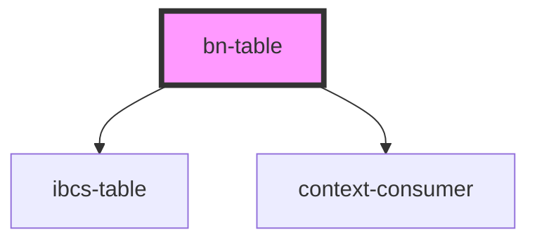

# bn-table

  

<!-- Auto Generated Below -->

## Properties

| Property       | Attribute       | Description | Type     | Default     |
| -------------- | --------------- | ----------- | -------- | ----------- |
| `elementTitle` | `element-title` |             | `string` | `undefined` |
| `scenarios`    | `scenarios`     |             | `string` | `undefined` |

## Dependencies

### Depends on

- ibcs-table
- context-consumer

### Graph

----------------------------------------------

*Built with [StencilJS](https://stenciljs.com/)*
