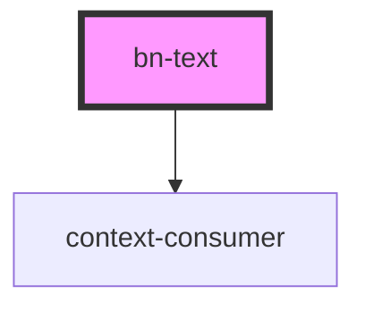

# bn-text

<!-- Auto Generated Below -->

## Properties

| Property      | Attribute | Description | Type     | Default     |
| ------------- | --------- | ----------- | -------- | ----------- |
| `dataSources` | --        |             | `{}`     | `undefined` |
| `value`       | `value`   |             | `string` | `undefined` |

## Dependencies

### Depends on

- context-consumer

### Graph

----------------------------------------------

*Built with [StencilJS](https://stenciljs.com/)*
