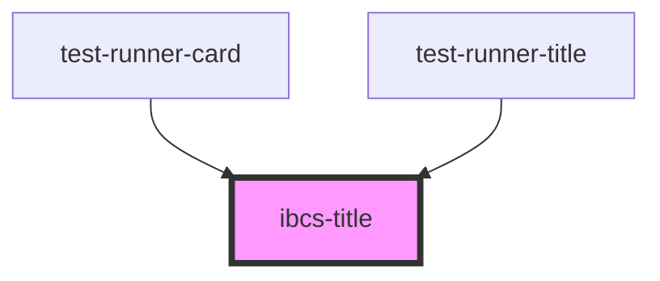

# my-component

<!-- Auto Generated Below -->

## Properties

| Property            | Attribute             | Description | Type                            | Default                                                       |
| ------------------- | --------------------- | ----------- | ------------------------------- | ------------------------------------------------------------- |
| `businessUnit`      | `business-unit`       |             | `string`                        | `''`                                                          |
| `i18n`              | --                    |             | `Map<string, string>`           | `new Map<string, string>()`                                   |
| `i18nMode`          | `i18n-mode`           |             | `I18nMode.ALL \| I18nMode.META` | `I18nMode.ALL`                                                |
| `intervalSpanLimit` | `interval-span-limit` |             | `number`                        | `28`                                                          |
| `measures`          | --                    |             | `IMeasureEntry[]`               | `[]`                                                          |
| `order`             | --                    |             | `IOrder`                        | `{     hierarchy: [],     direction: OrderDirection.ASC,   }` |
| `scenarios`         | --                    |             | `string[]`                      | `[]`                                                          |
| `timeperiod`        | --                    |             | `ITimePeriod \| undefined`      | `undefined`                                                   |

## Methods

### `setBusinessUnit(businessUnit: string) => Promise<void>`

#### Parameters

| Name           | Type     | Description |
| -------------- | -------- | ----------- |
| `businessUnit` | `string` |             |

#### Returns

Type: `Promise<void>`

### `setProps(data: Partial<IbcsTitle>) => Promise<void>`

#### Parameters

| Name   | Type                                                                                                                                                                                                                                                                                                                                                                                                                                                                                                                                                                                                                                               | Description |
| ------ | -------------------------------------------------------------------------------------------------------------------------------------------------------------------------------------------------------------------------------------------------------------------------------------------------------------------------------------------------------------------------------------------------------------------------------------------------------------------------------------------------------------------------------------------------------------------------------------------------------------------------------------------------- | ----------- |
| `data` | `{ businessUnit?: string \| undefined; setBusinessUnit?: ((businessUnit: string) => Promise<void>) \| undefined; setProps?: ((data: Partial<IbcsTitle>) => Promise<void>) \| undefined; scenarios?: string[] \| undefined; measures?: IMeasureEntry[] \| undefined; timeperiod?: ITimePeriod \| undefined; intervalSpanLimit?: number \| undefined; order?: IOrder \| undefined; i18n?: Map<string, string> \| undefined; i18nMode?: I18nMode \| undefined; render?: (() => any) \| undefined; componentWillLoad?: (() => void) \| undefined; componentWillUpdate?: (() => void) \| undefined; componentWillRender?: (() => void) \| undefined; }` |             |

#### Returns

Type: `Promise<void>`

## Dependencies

### Used by

 - [test-runner-card](../../test-runner)
 - [test-runner-title](../../test-runner)

### Graph

----------------------------------------------

*Built with [StencilJS](https://stenciljs.com/)*
