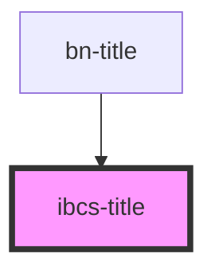

# my-component

<!-- Auto Generated Below -->

## Properties

| Property            | Attribute             | Description                                                   | Type                            | Default                                                       |
| ------------------- | --------------------- | ------------------------------------------------------------- | ------------------------------- | ------------------------------------------------------------- |
| `businessUnit`      | `business-unit`       |                                                               | `string`                        | `""`                                                          |
| `i18n`              | --                    |                                                               | `Map<string, string>`           | `new Map<string, string>()`                                   |
| `i18nMode`          | `i18n-mode`           |                                                               | `I18nMode.ALL \| I18nMode.META` | `I18nMode.ALL`                                                |
| `intervalSpanLimit` | `interval-span-limit` |                                                               | `number`                        | `28`                                                          |
| `locale`            | `locale`              | Locale used to format the date-link labels (e.g. "en", "de"). | `string`                        | `"de"`                                                        |
| `measures`          | --                    |                                                               | `MeasureEntry[]`                | `[]`                                                          |
| `order`             | --                    |                                                               | `Order`                         | `{     hierarchy: [],     direction: OrderDirection.ASC,   }` |
| `ruleSetConfig`     | --                    |                                                               | `RuleSetConfig`                 | `undefined`                                                   |
| `scenarios`         | --                    |                                                               | `string[]`                      | `[]`                                                          |
| `timeperiod`        | --                    |                                                               | `TimePeriod`                    | `undefined`                                                   |

## Methods

### `setBusinessUnit(businessUnit: string) => Promise<void>`

#### Parameters

| Name           | Type     | Description |
| -------------- | -------- | ----------- |
| `businessUnit` | `string` |             |

#### Returns

Type: `Promise<void>`

### `setProps(data: Partial<IbcsTitle>) => Promise<void>`

#### Parameters

| Name   | Type                                                                                                                                                                                                                                                                                                                                                                                                                                                                                          | Description |
| ------ | --------------------------------------------------------------------------------------------------------------------------------------------------------------------------------------------------------------------------------------------------------------------------------------------------------------------------------------------------------------------------------------------------------------------------------------------------------------------------------------------- | ----------- |
| `data` | `{ businessUnit?: string; setBusinessUnit?: (businessUnit: string) => Promise<void>; setProps?: (data: Partial<IbcsTitle>) => Promise<void>; scenarios?: string[]; measures?: MeasureEntry[]; timeperiod?: TimePeriod; intervalSpanLimit?: number; order?: Order; i18n?: Map<string, string>; i18nMode?: I18nMode; locale?: string; ruleSetConfig?: RuleSetConfig; render?: () => any; componentWillLoad?: () => void; componentWillUpdate?: () => void; componentWillRender?: () => void; }` |             |

#### Returns

Type: `Promise<void>`

## Dependencies

### Used by

 - [bn-title](..)

### Graph

----------------------------------------------

developed by Bino Bi
