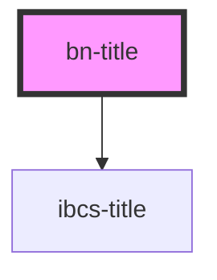

# bn-title

<!-- Auto Generated Below -->

## Properties

| Property         | Attribute         | Description                                                                    | Type              | Default     |
| ---------------- | ----------------- | ------------------------------------------------------------------------------ | ----------------- | ----------- |
| `businessUnit`   | `business-unit`   | (optional) Name of business unit. If empty buisnes unit row is omitted         | `string`          | `undefined` |
| `dateEnd`        | `date-end`        |                                                                                | `string`          | `undefined` |
| `dateFormat`     | `date-format`     |                                                                                | `string`          | `undefined` |
| `dateLink`       | `date-link`       |                                                                                | `string`          | `undefined` |
| `dateStart`      | `date-start`      |                                                                                | `string`          | `undefined` |
| `measures`       | `measures`        |                                                                                | `string`          | `undefined` |
| `order`          | `order`           | (optional) Sets the primary scenario on which the order direction is applied   | `string`          | `undefined` |
| `orderDirection` | `order-direction` | (optional) The icon to display                                                 | `"asc" \| "desc"` | `'asc'`     |
| `scenarios`      | `scenarios`       | (optional) List of scenarios.\  Valid scenarios are *( ac \| fc \| py \| pl )* | `string`          | `undefined` |

## Dependencies

### Depends on

- ibcs-title

### Graph

----------------------------------------------

*Built with [StencilJS](https://stenciljs.com/)*
