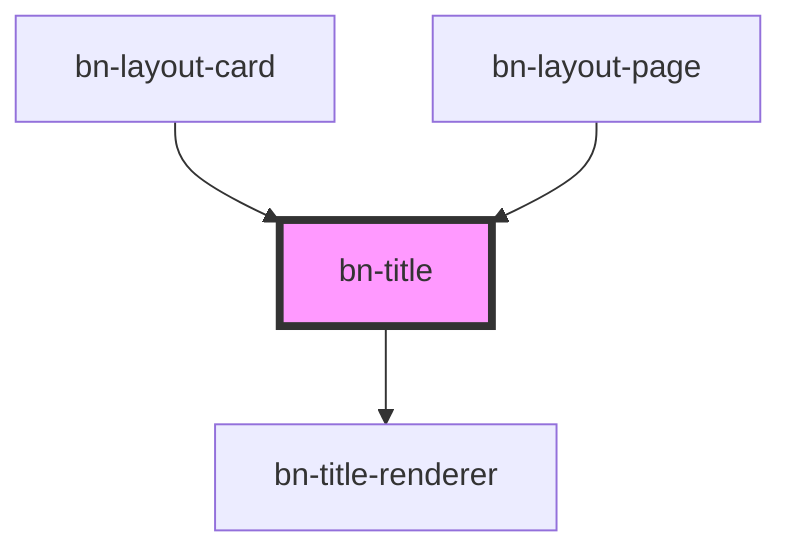

# bn-title

IBCS-compliant title block displaying business unit, scenario labels, measures, date range, and sort order. Placed before [`<bn-body>`](../bn-body/readme.md) inside a [`<bn-page>`](../bn-page/readme.md).

## Usage

```html
<bn-title
  business-unit="ACME Corp"
  scenarios="ac1,pl1"
  variances="dac1_pl1_pos"
  measures='[{"name":"Revenue","unit":"mEUR"}]'
  date-start="2024-01-01"
  date-end="2024-12-31"
  date-format="month"
  date-link="interval"
  order="ac1"
  order-direction="desc">
</bn-title>
```

### Measures

Pass measures as a JSON array of `{name, unit}` objects:

```html
<!-- Single measure -->
<bn-title measures='[{"name":"Revenue","unit":"mEUR"}]'></bn-title>

<!-- Multiple measures with same unit (units are deduplicated) -->
<bn-title measures='[{"name":"Revenue","unit":"mEUR"},{"name":"Costs","unit":"mEUR"}]'></bn-title>

<!-- Multiple measures with different units -->
<bn-title measures='[{"name":"Revenue","unit":"mEUR"},{"name":"Margin","unit":"%"}]'></bn-title>
```

### Date Formats

| Value | Example Output |
|-------|---------------|
| `year` | 2024 |
| `quarter` | Q1 2024 |
| `month` | Jan 2024 |
| `week` | KW01 2024 |
| `day` | 01.01.2024 |
| `hour` | 01.01.2024 14:00:00 |
| `auto` | Auto-detected |
| `none` | Raw date |

### Date Links

| Value | Pattern | Example |
|-------|---------|---------|
| `interval` | start..end | Jan 2024..Dec 2024 |
| `start` | .start | .Jan 2024 |
| `end` | end. | Dec 2024. |
| `avg` | avg | Jan 2024 |
| `ytd` | year-to-date | _Dec 2024 |
| `ytg` | year-to-go | Dec 2024_ |
| `cum` | cumulative | Jan 2024_Dec 2024 |
| `mat` | moving annual total | ~Dec 2024 |
| `none` | single date | Jan 2024 |

<!-- Auto Generated Below -->


## Overview

Composes an IBCS-compliant report title block.

Renders business unit, scenario labels, measure names with units, a
formatted date/time period, and sort-order indicators as a structured
header. Delegates the actual layout to the inner `bn-title-renderer` element.

## Properties

| Property         | Attribute         | Description                                                                                                                                                                                                                                                                                                                                                                                                                                                                                                                                        | Type     | Default      |
| ---------------- | ----------------- | -------------------------------------------------------------------------------------------------------------------------------------------------------------------------------------------------------------------------------------------------------------------------------------------------------------------------------------------------------------------------------------------------------------------------------------------------------------------------------------------------------------------------------------------------- | -------- | ------------ |
| `businessUnit`   | `business-unit`   | Name of the business unit displayed in card header. If empty string (`''` or `null`) the business unit row is omitted <br /><br /> Rendered as sanitized HTML, so inline markup such as ```<b>```, ```<i>``` and ```<br />``` is supported.                                                                                                                                                                                                                                                                                                        | `string` | `""`         |
| `dateEnd`        | `date-end`        | String of end date <br /><br /> format:<br /> ``` yyyy-MM-dd ```                                                                                                                                                                                                                                                                                                                                                                                                                                                                                   | `string` | `undefined`  |
| `dateFormat`     | `date-format`     | Date format <br /><br /> values:<br /> ``` year // quarter // month // week // day // hour // auto // none ``` <br /><br />  detail:<br /> ```year: "YYYY"```<br /> ```quarter:  "Q[Q] YYYY"```<br /> ```month: "MMM YYYY"```<br /> ```week: "[KW]WW YYYY"```<br /> ```day: "DD.MM.YYYY"```<br /> ```time: "DD.MM.YYYY HH:mm:ss"```<br /> ```none: "DD.MM.YYYY"```<br />                                                                                                                                                                           | `string` | `"none"`     |
| `dateLink`       | `date-link`       | Format in which the start and end date are linked. <br /><br /> If empty string (`''` or `null`) the date row is omitted <br /><br /> values:<br /> ``` avg // interval // cum // start // end // ytd // ytg // cum // mat // none // null``` <br /><br />  detail:<br /> ```avg: "Ø[DATE]"```<br /> ```interval: "[DATE]..[DATE2]"```<br /> ```start: ".[DATE]"```<br /> ```end: "[DATE]."```<br /> ```ytd: "_[DATE]"```<br /> ```ytg: "[DATE]_"```<br /> ```cum: "[DATE]_[DATE2]"```<br /> ```mat: "~[DATE]"```<br /> ```none: "[DATE]"```<br /> | `string` | `"none"`     |
| `dateStart`      | `date-start`      | String of start date <br /><br /> format:<br /> ``` yyyy-MM-dd ```                                                                                                                                                                                                                                                                                                                                                                                                                                                                                 | `string` | `undefined`  |
| `i18nNamespace`  | `i18n-namespace`  | Namespace of the translations to use (the `namespace` of a `<bn-internationalization>`). Without it the component takes the `i18n-namespace` of the nearest ancestor that has one, then the built-in texts.                                                                                                                                                                                                                                                                                                                                        | `string` | `undefined`  |
| `measures`       | `measures`        | Stringified Array of measure objects {name: string, unit: string} <br /><br /> If all units are the same the redundant units will be reduced and names concatenated.<br /> If unit is empty string (`''` or `null`) the row is omitted <br /><br /> example:<br /> ``` [{"name": "Bruttoumsatz", "unit": "mEUR"}] ```                                                                                                                                                                                                                              | `string` | `undefined`  |
| `order`          | `order`           | List of the primary scenarios on which the order direction are applied. <br /><br /> If order is set to a scenario it has also exists in scenariolist.<br /> If order is empty string (`''` or `null`) the order arrow is omitted <br /><br /> values:<br /> ``` category // categoryindex // rowgroup // rowgroup // rowgroupindex // ac // fc // py // pl // null ```                                                                                                                                                                            | `string` | `"category"` |
| `orderDirection` | `order-direction` | Sets sorting order directon <br /><br /> values:<br /> ``` asc // desc ```                                                                                                                                                                                                                                                                                                                                                                                                                                                                         | `string` | `"asc"`      |
| `ruleset`        | `ruleset`         | Name of a registered IBCS rule set (see `bn-ruleset`) used for scenario ordering. Supports `"inherited-closest"` / `"inherited-page"` to take over the value from an ancestor `bn-layout-card` / `bn-layout-page`.                                                                                                                                                                                                                                                                                                                                 | `string` | `undefined`  |
| `scenarios`      | `scenarios`       | List of scenarios displayed in card header. <br /><br /> If scenarios is empty string (`''` or `null`) the scenarios are omitted <br /><br /> values:<br /> ```ac // fc // py // pl // null```                                                                                                                                                                                                                                                                                                                                                     | `string` | `undefined`  |
| `selectedStyle`  | `selected-style`  | Name of the component style to use (the `name` of a `<bn-component-style>`). Its values go on top of the default style.                                                                                                                                                                                                                                                                                                                                                                                                                            | `string` | `undefined`  |
| `variances`      | `variances`       | <br /> <br /> List of Variances The additonal variances which are calculated form the given scenarios. the scenarios used in the variances have also be defined in the *scenarios* property. <br /> <br /> the variance is defiend as  (Scenario A -  ScenarioB) neu. neg and pos post fix defines which value is *good* a negative or a positive value. <br /> <br /> if empty variance charts are hidden <br /> <br /> each variance creates a chart <br /> <br /> pattern:<br />  ```d<scenarioB>_<scenarioA>_[pos/neg/neu]```                  | `string` | `undefined`  |


## Dependencies

### Used by

 - [bn-layout-card](../bn-layout-card)
 - [bn-layout-page](../bn-layout-page)

### Depends on

- bn-title-renderer

### Graph


----------------------------------------------

developed by Bino Bi
